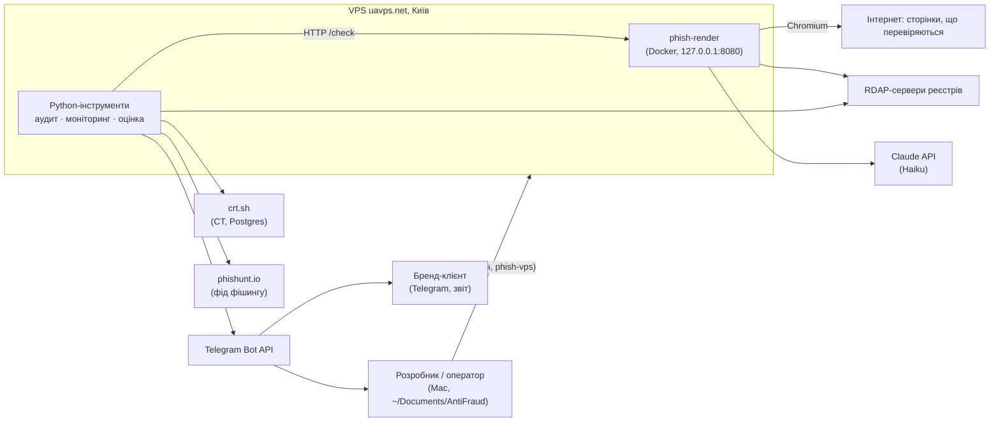
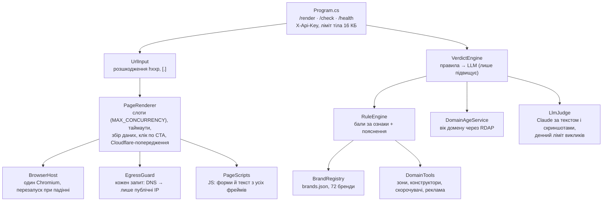
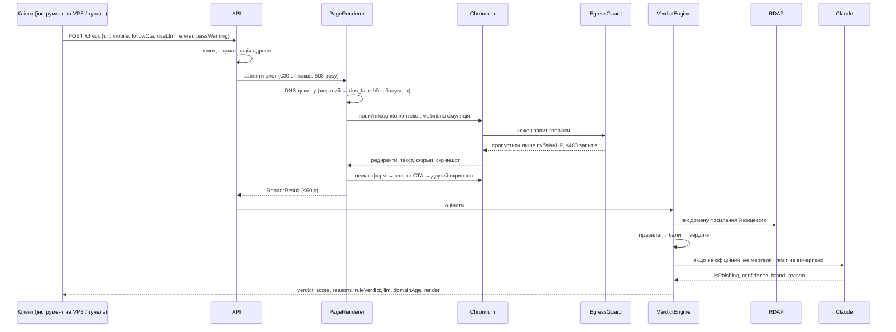
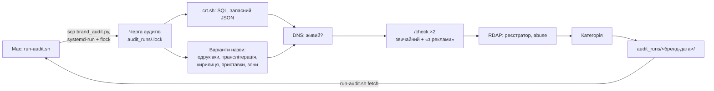
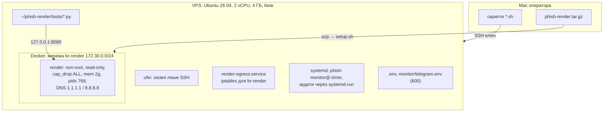
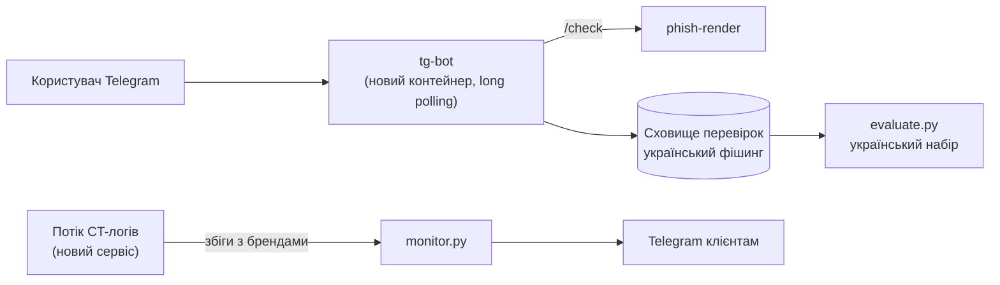

# Архітектура AntiFraud

Стан на 10 листопада 2026.

## 1. Призначення

Система відповідає на два питання:

1. **Чи це посилання — фішинг?** Приймає адресу, відкриває її в ізольованому браузері, повертає вердикт із поясненнями.
2. **Хто клонує бренд?** Шукає схожі домени (журнал сертифікатів + варіанти назви), перевіряє живі, складає звіт для бренду і щодня повідомляє про зміни.

Перше — ядро для майбутнього Telegram-бота для людей. Друге — послуга для брендів (перший клієнт у роботі — Kachorovska).

## 2. Контекст

Ззовні на сервер веде лише SSH. Сервіс рендеру слухає тільки `127.0.0.1`, тож користуються ним лише процеси на самому VPS або оператор через SSH-тунель.

## 3. Компоненти

### 3.1 phish-render — сервіс рендеру й вердикту

ASP.NET Core (.NET 10, minimal API), Microsoft.Playwright 1.60 (Chromium 148), Docker. Код: `phish-render/src/RenderService/`.

| Компонент | Відповідальність |
|---|---|
| `Program.cs` | Маршрути, перевірка ключа сталим часом, реєстрація сервісів, старт браузера до першого запиту |
| `RenderSettings` | Налаштування з оточення (`.env`) з межами значень; без `RENDER_API_KEY` (≥24 символи) сервіс не стартує |
| `PageRenderer` | Черга на слоти рендеру (503 `busy` після `QUEUE_TIMEOUT_MS`), навігація, редиректи, скриншоти, клік по CTA, `referer`, `passWarning` |
| `BrowserHost` | Один процес Chromium на сервіс; кожна сторінка — новий incognito-контекст |
| `EgressGuard` | Захист від SSRF: блокує запити сторінки на приватні, loopback і metadata-адреси |
| `VerdictEngine` | Вік домену (посилання і кінцевого, береться наймолодший) → правила → LLM |
| `RuleEngine` | Сума балів за ознаки, пороги 35 і 60, людські пояснення в `reasons` |
| `LlmJudge` | Друга думка Claude; може лише підвищити вердикт |
| `BrandRegistry` | Бренди й офіційні домени; спільні хостинги під доменом бренду офіційними не вважаються |

Деталі вердикту — у [detection.md](detection.md), API — у [README сервісу](../phish-render/README.md).

### 3.2 Python-інструменти (на хості VPS, поза контейнером)

Лише стандартна бібліотека Python: на сервері нічого не треба ставити. Звертаються до сервісу по `http://127.0.0.1:8080` з ключем із `.env`.

| Інструмент | Що робить | Результат |
|---|---|---|
| `tools/brand_audit.py` | Кандидати з CT і варіантів назви → DNS → `/check` двічі (звичайний візит і «з реклами») → RDAP → категорія | `summary.md`, `candidates.csv`, `ct_history.csv`, скриншоти |
| `tools/monitor.py` | Аудит → порівняння з учорашнім станом → події → Telegram | `monitor/state/`, `monitor/runs/` |
| `tools/fetch_feed.py` | Свіжий фішинг із phishunt.io, лише домени, яких ще не було в оцінках | CSV для `evaluate.py` |
| `tools/evaluate.py` | `/check` на розмічених наборах: «тільки правила» і «правила + LLM» | `report.md`, `results.csv` |
| `tools/batch_render.py` | Прогін CSV через `/render` | `render_out/summary.csv` |

### 3.3 Скрипти оператора (Mac, корінь `AntiFraud/`)

`deploy.sh`, `run-audit.sh`, `monitor.sh`, `run-eval.sh`, `run-tests.sh`, `set-llm-key.sh`, `ssh-setup.sh`, спільне `vps-common.sh`. Усі ходять на сервер по SSH через одне спільне з'єднання (ControlMaster) і забирають результати в локальні папки `audit-*`, `eval-results-*`, `render-results-*`. Див. [operations.md](operations.md).

## 4. Потоки даних

### 4.1 Перевірка посилання (`POST /check`)

### 4.2 Аудит клонів бренду

Аудити йдуть як окремі systemd-юніти, тож обрив SSH їх не зупиняє. `flock` ставить кілька аудитів у чергу, щоб вони не ділили два слоти рендеру.

### 4.3 Щоденний моніторинг

systemd-таймер `phish-monitor@<бренд>.timer` (07:40 за Києвом, ±10 хв) → `monitor.py`: перевіряє `/health` → аудит → порівняння з `state/<бренд>.json` → події → Telegram (адміну щоденне зведення, клієнту лише зміни) → `state/<бренд>-events.jsonl`, `runs/` (останні 30). Таймер ставиться **вимкненим** і вмикається лише після згоди клієнта. Деталі в [brand-audit.md](brand-audit.md).

### 4.4 Оцінка точності

`fetch_feed.py` (phishunt.io, лише нові домени) + `legit_ua.csv` + тестовий набір → `evaluate.py` → `/check` з LLM і без → `report.md`. Запуск з Mac: `run-eval.sh`.

## 5. Розгортання

| Що | Де |
|---|---|
| Сервер | uavps.net, тариф VPS-NVMe-4, IP `91.228.218.128`, SSH-скорочення `phish-vps` |
| Код на сервері | `~/phish-render/` (розпакований архів) |
| Контейнер | `docker compose` проєкт `phish-render`, сервіс `render`, `restart: unless-stopped` |
| Налаштування | `~/phish-render/.env` |
| Результати аудитів | `~/phish-render/audit_runs/` |
| Стан моніторингу | `~/phish-render/monitor/state/`, `runs/`, `telegram.env` |
| Код на Mac | `~/Documents/AntiFraud/` (не під git) |

## 6. Безпека

### 6.1 Модель загроз

| Загроза | Захист |
|---|---|
| Ворожа сторінка ламає браузер (RCE у Chromium) | Окремий порожній VPS; контейнер non-root, read-only, без capabilities, `no-new-privileges`, ліміти пам'яті й процесів; iptables не пускає контейнер у приватні мережі й до хоста |
| Сторінка ходить у внутрішню мережу (SSRF) | `EgressGuard` перевіряє кожен запит на публічний IP; iptables блокує приватні діапазони й `169.254.169.254` |
| Сторінка «вмовляє» LLM (prompt injection) | LLM може лише підвищити вердикт; правила рахуються незалежно |
| Несанкціонований доступ до API | Порт лише на `127.0.0.1`; ключ `X-Api-Key` порівнюється сталим часом |
| Вичерпання ресурсів | Слоти рендеру, черга 30 с, жорсткий таймаут 60 с, ≤400 запитів на сторінку, ліміт тіла 16 КБ |
| Витрати на LLM | `LLM_DAILY_LIMIT` (300 викликів на добу, ≈$0.20) |
| Витік ключів | Секрети лише в `.env` і `telegram.env` на сервері (600), не потрапляють в архів і контейнерний образ |
| Сканер бачить заглушку (cloaking) | Мобільна емуляція, звичайний User-Agent, візит «з реклами», VPS з українським IP |

### 6.2 Секрети

| Секрет | Де живе | Хто читає |
|---|---|---|
| `RENDER_API_KEY` | `.env` на сервері | сервіс, Python-інструменти |
| `ANTHROPIC_API_KEY` | `.env` на сервері; на Mac — `phish-render/api-key` для `set-llm-key.sh` | `LlmJudge` |
| Токен Telegram-бота, чат адміна | `monitor/telegram.env` на сервері; на Mac — файл `tg-bot-api` | `monitor.py` |
| SSH-ключ | `~/.ssh/id_ed25519` на Mac | скрипти оператора |

### 6.3 Відомі слабкі місця

- Chromium працює з `--no-sandbox`. Компенсується ізоляцією контейнера й окремим сервером.
- Секрети на Mac лежать відкритими файлами (`api-key`, `tg-bot-api`).

## 7. Ключові рішення

| # | Рішення | Чому | Ціна |
|---|---|---|---|
| D1 | Справжній Chromium замість завантаження HTML | Фішинг збирає сторінку скриптами, ховає форму від десктопів і сканерів | Повільніше (секунди на адресу), потрібна ізоляція |
| D2 | Спершу правила, LLM лише підвищує | Захист від prompt injection, пояснюваність, робота без ключа | LLM не виправляє хибні тривоги правил |
| D3 | Сервіс не публічний, доступ через SSH | Мінімальна поверхня атаки | Для бота знадобиться окремий публічний компонент |
| D4 | Інструменти на чистій stdlib Python | Нічого не ставити на сервер, менше залежностей | Більше ручного коду (HTTP, multipart) |
| D5 | crt.sh через публічну базу Postgres | Веб-API crt.sh з VPS повертав порожнє | Пошук лише за префіксом назви |
| D6 | Оцінка лише на нових доменах (`feed_seen`) | Чесні цифри без підгонки правил | Набори малі, глобальний фід |
| D7 | Таймер моніторингу ставиться вимкненим | Не надсилати клієнту нічого без згоди | Ручний крок `monitor.sh on` |
| D8 | Подвійний рендер у аудиті (звичайний і «з реклами») | Клони показують підробку лише трафіку з реклами | Удвічі більше рендерів |
| D9 | Один VPS у Києві | Дешево; український IP обходить геоклоакінг | Єдина точка відмови |

## 8. Якісні характеристики

| Характеристика | Поточний рівень |
|---|---|
| Точність (прогін 5, правила + LLM) | Точність 100%, повнота «фішинг» 73%, «фішинг + підозріло» 100%, хибних тривог 0 з 52 |
| Вартість | ≈$0.0005 за перевірку з LLM; VPS — фіксована плата |
| Пропускна здатність | 2 паралельні рендери (`MAX_CONCURRENCY`), 5–20 с на адресу |
| Аудит бренду | Близько 3 хв на невеликий бренд (Kachorovska: 5484 кандидати, 9 живих); великі бренди довше |
| Відновлення | `restart: unless-stopped`; `BrowserHost` перезапускає браузер при падінні; аудити переживають обрив SSH |

## 9. Технічний борг і ризики

| Ризик | Наслідок | Що зробити |
|---|---|---|
| Код не під контролем версій | Немає історії й відкату, легко загубити зміни | `git init` + приватний репозиторій; `.gitignore` уже виключає секрети |
| Немає юніт-тестів правил | Зміна ваг може непомітно зламати вердикти | Тестовий проєкт для `RuleEngine` на збережених `RenderResult` |
| Один сервер, без резервних копій | Втрата `monitor/state` і журналу подій | Щоденна копія `monitor/state/` на Mac або в об'єктне сховище |
| Залежність від crt.sh | Падіння crt.sh ламає частину аудиту | Власний потік CT-логів (дорожня карта) |
| Пошук у CT за префіксом | Пропускаються `fbkachorovska.top`-подібні назви | Потік CT-логів із пошуком підрядка |
| Глобальний фід для оцінки | Цифри можуть не переноситись на український фішинг | Збирати український фішинг через бота, CERT-UA |
| `--no-sandbox` | Втеча з браузера дає контейнер | Тримати сервер порожнім; згодом gVisor або окрема VM на рендер |
| Сервер у README описаний як «у Німеччині» | Застарілий опис обмеження геоклоакінгу | Оновити README |

## 10. Куди рухаємось

1. **Telegram-бот для людей.** Окремий контейнер на тому ж VPS. Long polling, тож вхідний порт не потрібен; до `/check` ходить по внутрішній мережі. Потрібні: ліміт перевірок на користувача, черга (рендер повільний, 2 слоти), сховище надісланих адрес. Так з'явиться джерело українського фішингу.
2. **Власний потік CT-логів.** Читати нові сертифікати напряму з CT-логів і шукати назву бренду будь-де в домені. Збіги одразу йдуть у моніторинг як події «новий сертифікат».
3. **Кілька клієнтів-брендів.** Уже підтримано файлами `monitor/<бренд>.json`; далі — окремі чати й звіти на клієнта, місячний звіт з `events.jsonl`.
4. **Масштабування рендеру.** Коли бот дасть навантаження: більше RAM (≈1,5 ГБ на слот) або другий вузол рендеру за чергою.
